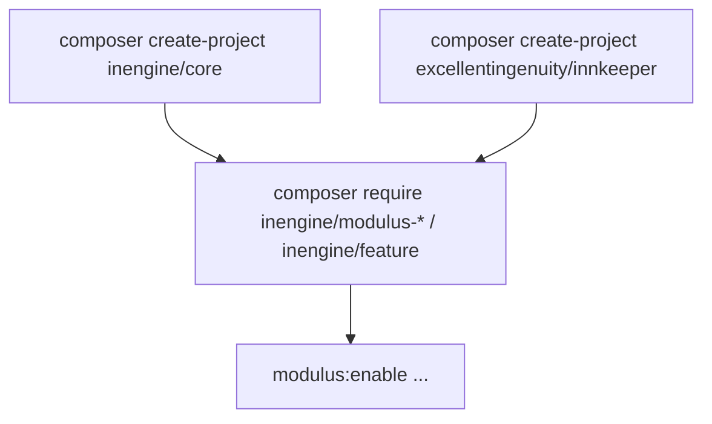

# InEngine — Distribution and Installation

Living notes on how operators and product repos should **acquire** Core, Modulus, and feature modules. Written while prepping the **InnKeeper** product tree (`~/Projects/InnKeeper`) ahead of a Modulus-ready Core beta.

Related: [Plan and Design.md](Plan%20and%20Design.md) · product stub: `../InnKeeper` (sibling under `Projects/`).

---

## Short answer

Use **both** shapes — they solve different jobs:

| Artifact | Composer shape | How you install it |
|----------|----------------|--------------------|
| **Core** | `type: project` (like `laravel/laravel`) | `composer create-project inengine/core my-app` |
| **Modulus** | package (`inengine/modulus`) | Required **by Core**; also `composer require` into any Laravel host that wants the runtime |
| **Feature modules** | packages (`inengine/{feature}`) | Create from public [Skeleton](https://github.com/InEngine/Skeleton) template (not Packagist), then `composer require` + `modulus:enable` |
| **Modulus extensions** | packages (`inengine/modulus-{role}`) | Optional `composer require` — public MIT for Composer; **`modulus-ui` private Pro**; marketplace/inspect planned |
| **Products** (InnKeeper, Provost, …) | `type: project` | `composer create-project …` **or** clone + `composer install` — a Core-shaped app with product modules pre-declared. **InnKeeper = unreleased source** until published |

Do **not** try to ship Core only as a library you `require` into a blank Laravel app as the primary path. Core *is* the opinionated host (routes shell, Vite, Pest, Livewire, early Modulus boot). Treating it like a package fights that role and duplicates what `create-project` already does well.

Do **not** fold InnKeeper (or Provost) into one giant monolith package either. Product code that other products should reuse belongs in **`inengine/innkeeper-*` (or shared) modules**; the product repo stays the composition root + branding + provisioning glue.

---

## Why not “only packages” or “only create-project”?

### Only `composer require` (everything is a package)

**Works well for:** Modulus, feature modules, Modulus extensions — anything that enables/disables and must SemVer independently.

**Fails as the primary story for Core:** a blank `laravel new` plus twenty `require`s recreates Core poorly, drifts from the blessed stack, and skips Core’s composition-root assumptions (no default User in Core, Modulus boots early, discovery gating).

**Fails as the only story for a product:** motel operators and EIG hosting need “spin up InnKeeper,” not “assemble fourteen packages by hand.”

### Only `composer create-project` (everything is a project)

**Works well for:** Core and product apps (deployable roots, `.env`, Herd sites, CI).

**Fails for modules:** you cannot enable/disable or share Calendar/Alert/Innkeeper-inventory across products if they only exist as forked app trees. Modulus’s whole point is **Composer packages + enable state**.

### Hybrid (recommended)



1. **Greenfield platform / custom product** → `create-project inengine/core`, then require + enable modules.  
2. **Named product (InnKeeper)** → `create-project` (or git clone) of the **product project**, which already lists Core-equivalent stack + `inengine/innkeeper-*` (and shared) modules.  
3. **Day-2 add-ons** → `composer require` + Modulus enable (marketplace / `modulus-composer` later).

Install ≠ enable (see Plan and Design): acquire with Composer, then `modulus:enable`.

---

## Recommended public install flows

### A. Core (platform host)

```bash
composer create-project inengine/core my-engine
cd my-engine
# modulus already required by Core once published
php artisan modulus:list
composer require inengine/some-module
php artisan modulus:enable inengine/some-module
```

Until Packagist (or private Packagist) publishes SemVer builds, local/CI use **path / VCS** repos — same pattern as Core’s `composer.local.dist.json`.

### B. InnKeeper (product)

Target UX when distribution is ready:

```bash
composer create-project excellentingenuity/innkeeper my-motel-site
# or: git clone … && composer install
cd my-motel-site
cp .env.example .env && php artisan key:generate
php artisan migrate
php artisan modulus:enable …   # if product modules ship disabled by default
```

Product `composer.json` stays `type: project`. It should **not** depend on “copy Core by hand forever”; long-term options (pick when packaging Core for release):

1. **Synced Core skeleton** — product is a create-project sibling of Core (Provost-style today): Laravel app tree + requires modules. Simple; Core fixes merge forward carefully.  
2. **Core as path/VCS project template** — release Core tags; product create-project is a thin preset (extra requires, seeders, InnKeeper config) generated from Core.  
3. **Avoid:** `composer require inengine/core` into Laravel as the main product path (Core is not designed as a drop-in package).

Until that is decided, **InnKeeper** lives as an empty-ish product repo that will **pull / create-project from Core** once Modulus beta install story is stable — see `~/Projects/InnKeeper/README.md`.

### C. Module authors

```bash
# from InEngine/Skeleton
composer require inengine/my-module   # in a Core or product host
php artisan modulus:enable inengine/my-module
```

---

## Local monorepo / sibling-Projects layout (today)

While packages are unpublished:

| Path | Role |
|------|------|
| `Projects/InEngine/Core` | Host / create-project source |
| `Projects/InEngine/Modules/*` | Path-required packages |
| `Projects/Provost/web` | Education product (Core-shaped project) |
| `Projects/InnKeeper` | Hotel/motel product stub → later Core-shaped project |
| `Projects/Fairview` | InnKeeper brochure **design dogfood** (Laravel app; not the product root forever) |

Wire with Composer path repositories (and optional merge-plugin), e.g.:

```json
{
  "repositories": [
    { "type": "path", "url": "../InEngine/Modules/Modulus", "options": { "symlink": true } },
    { "type": "path", "url": "../InEngine/Modules/*", "options": { "symlink": true } }
  ]
}
```

Production replaces path repos with Packagist / private Packagist / Git tags.

---

## Licensing (locked 2026-11-19)

| Work | License / visibility |
|------|----------------------|
| Core, Modulus, Modulus Composer, Skeleton | **MIT** — public GitHub / Packagist when published |
| Feature modules (Alert, …) | Prefer **MIT** unless a product needs otherwise |
| `inengine/modulus-ui` | **Private Pro** — commercial; private repo / private Composer; not public Packagist |
| InnKeeper (product) | **Unreleased source** — keep private until deliberately published under product terms |

Do not put Pro UI code inside MIT packages. Pro depends on Modulus; Modulus never depends on Pro.

## Decision checklist (when locking “how we ship”)

1. **Publish target:** public Packagist vs private Packagist vs VCS-only for early beta.  
2. **Core versioning:** SemVer tags on `inengine/core` create-project; document PHP/Laravel floor.  
3. **Product preset:** InnKeeper create-project name (`excellentingenuity/innkeeper` vs `inengine/innkeeper`) and which modules are required vs optional add-ons.  
4. **Fairview path:** migrate Fairview from standalone Laravel into InnKeeper-on-Core, or keep Fairview as content seed only.  
5. **Hosted vs self-serve:** EIG-hosted provision clones/create-projects the product; self-serve docs mirror the same Composer entrypoint.  
6. **Modulus marketplace:** optional later; does not replace Composer as source of truth for acquire.  
7. **`modulus-ui`:** private Pro packaging (license key / private Packagist) when scaffolded.

---

## Recommendation for InnKeeper specifically

- Treat **InnKeeper as a Composer project** (deployable app), same family as Provost/`inengine/core`.  
- Implement reusable lodging domains as **`inengine/innkeeper-*` packages** enabled by Modulus.  
- Keep **Fairview** as beta content + brochure UX reference until the product project can `create-project` / sync from Core.  
- Prefer **create-project + require modules** over “InnKeeper is one mega-package inside someone else’s Laravel.”

When Modulus lifecycle + published Core constraints are beta-ready, replace the InnKeeper stub with a real Core-derived tree and point its README install section at this document’s flow B.
